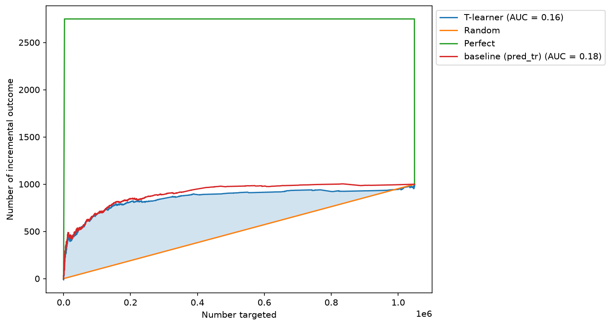

# A/B Test Analysis & Uplift Modeling (Criteo)

**Question:** do ads increase conversion, and can we get most of the effect by showing them only to some users?

An end-to-end experiment analysis on the public [Criteo Uplift dataset](https://ailab.criteo.com/criteo-uplift-prediction-dataset/)
(14M users, 85/15 treatment/control split): experiment design, validity checks, effect estimation,
variance reduction, simulation-based validation of the test, and uplift modeling for targeting.

## Key results

- Ads increase conversion from 0.194% to 0.309%: **+0.115 p.p. (+59%)**, 95% CI [0.107; 0.123] p.p., p < 0.001.
- With 14M users the minimum detectable effect is 4.8%, so the test is well powered. No SRM, all features balanced (|SMD| < 0.05).
- The test is well calibrated: in 1000 A/A simulations the false positive rate is 5.2% (α = 5%).
  Peeking after each of 20 "days" raises it to ~20%.
- Regression adjustment on pre-treatment features narrows the SE by 6.8%.
- The top 10% of users by the model show ~7× the average ad effect and bring about two thirds of all incremental conversions.
- A simple "who will buy" model ranks users about as well as the T-learner (Qini 0.18 vs 0.16).



## Project structure

| File | Content |
| --- | --- |
| `notebooks/01_ab_test.ipynb` | data overview, sample size and MDE, SRM, SMD, z-test, parametric bootstrap, regression adjustment |
| `notebooks/02_simulations.ipynb` | A/A tests, peeking |
| `notebooks/03_uplift.ipynb` | T-learner (CatBoost), uplift by decile, Qini curve and uplift@k vs baseline |
| `src/stats.py` | sample size, MDE, SRM check, z-test for proportions |

## Conclusions

1. Showing ads clearly pays off in conversion: the effect is statistically significant and far above the MDE.
2. The analysis method is trustworthy: A/A tests give the expected false positive rate, and the result was checked once, without peeking.
3. Most of the effect comes from a small share of users, so targeting can save most impressions.
   The final threshold depends on impression cost vs conversion value, which the dataset does not include.
4. On this data, purchase propensity and ad effect go together, so a plain response model works as well as uplift modeling.
   The T-learner improved with more data (Qini 0.12 → 0.16 from 25% to 50% of the data), so it was mainly limited by the small control group.

## Limitations

- The dataset is post-processed and the features are anonymized, so the SRM check is not very informative.
- `exposure` (actually saw the ad) is not randomized, so the analysis is intention-to-treat on `treatment`.
- Regression adjustment and ML use subsamples (2M rows and 50%) and a single train/test split.
- Next steps: X-learner (built for unbalanced groups like 85/15), tuning by Qini on validation, several random splits.

## How to run

```bash
python -m venv .venv && source .venv/bin/activate
pip install -r requirements.txt
```

1. Download the dataset and save it as `data/dataset.csv` (~3 GB, not included in the repo).
2. Run the notebooks in order: `01` creates `data/criteo.parquet`, which `02` and `03` use.

Note: `scikit-uplift` 0.5.1 is incompatible with recent scikit-learn; a small patch in the first cell of `03_uplift.ipynb` fixes it.